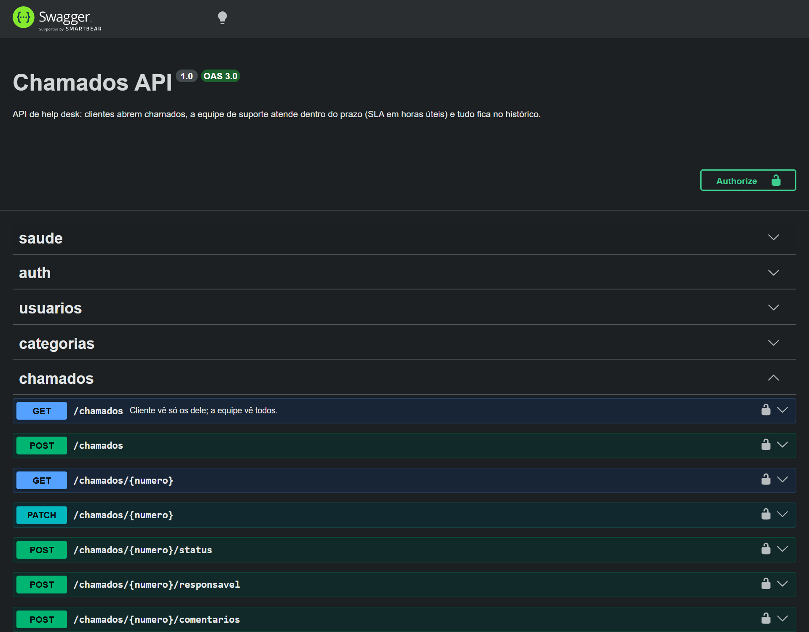

# Chamados API

API de help desk feita com **NestJS**. Clientes abrem chamados, a equipe de suporte atende dentro do prazo combinado (SLA) e tudo o que acontece fica registrado no histórico.



**Stack:** NestJS 12 · TypeScript · PostgreSQL · TypeORM (com migrations) · Redis + BullMQ · JWT · Swagger · Vitest + Supertest · Docker · GitHub Actions

## O que ela faz

- **Três papéis:** cliente (abre e acompanha os próprios chamados), agente (atende) e admin (também cuida de usuários e categorias).
- **Login com JWT** (access token de 15 min) e **refresh token que só vale uma vez.** Se um refresh token já usado aparecer de novo, todas as sessões daquele login caem.
- **SLA em horas úteis.** O prazo de resposta e o de solução dependem da prioridade e contam só de segunda a sexta, das 8h às 18h (horário de Brasília), sem os feriados nacionais.
- **O prazo pausa enquanto o chamado espera o cliente.** Quando o cliente responde, o chamado volta para a equipe e o prazo anda o tanto que ficou parado.
- **Fluxo de status com regras.** A equipe não pula etapas, o cliente pode cancelar ou reabrir (até 7 dias depois), e o sistema fecha sozinho o que ficou resolvido por 5 dias.
- **Comentários e notas internas.** A primeira resposta pública da equipe marca o "respondido em", e as notas internas o cliente não vê.
- **Notificações por fila (BullMQ).** A API só coloca o aviso na fila e responde na hora. Um worker grava a notificação e tenta de novo se der erro.
- **Relatório:** chamados abertos e resolvidos, % de SLA cumprido, tempo até a primeira resposta, nota média e ranking por agente.
- **Avaliação de 1 a 5** pelo cliente depois de resolvido.

## Rodando

Com Docker, a API, o Postgres e o Redis sobem juntos:

```bash
docker compose up -d --build
docker compose exec api node dist/banco/seed.js   # dados de demonstração (opcional)
```

A API fica em http://localhost:3000 e a documentação interativa (Swagger) em http://localhost:3000/docs.

Para desenvolver sem Docker na API (Node 24):

```bash
docker compose up -d db redis
cp .env.example .env
npm install
npm run db:migrar
npm run db:seed
npm run start:dev
```

**Logins da base de demonstração** (senha `demo1234`):

| Papel | E-mail |
|---|---|
| Admin | admin@chamados.dev |
| Agente | rafael@chamados.dev |
| Cliente | cliente@chamados.dev |

No Swagger, faça o login em `POST /auth/entrar`, copie o `accessToken` e cole em **Authorize**.

## Rotas principais

| Método | Rota | Quem usa |
|---|---|---|
| POST | `/auth/cadastro`, `/auth/entrar`, `/auth/renovar`, `/auth/sair` | qualquer um |
| GET | `/chamados?status=ABERTO,EM_ANDAMENTO&atrasados=true&responsavel=eu&busca=...` | todos (cliente vê só os dele) |
| POST | `/chamados` | todos |
| PATCH | `/chamados/:numero` (com `versao`) | dono enquanto está aberto, ou equipe |
| POST | `/chamados/:numero/status` | depende da transição |
| POST | `/chamados/:numero/responsavel` | agente (para si) e admin |
| POST | `/chamados/:numero/comentarios` | todos (nota interna só a equipe) |
| GET | `/chamados/:numero/historico` | todos |
| POST | `/chamados/:numero/avaliacao` | quem abriu |
| GET | `/notificacoes` | todos |
| GET | `/relatorios/resumo?de=2026-10-01&ate=2026-10-31` | agente e admin |
| GET/POST/PATCH | `/usuarios`, `/categorias` | admin |
| GET | `/saude` | healthcheck (banco e Redis) |

## Decisões que tomei

**Dois agentes clicando em "pegar" ao mesmo tempo.** O UPDATE só grava se o chamado ainda estiver sem responsável (`WHERE responsavel_id IS NULL`). Quem chega depois recebe 409. Tem teste disparando as duas requisições juntas.

**Duas pessoas editando o mesmo chamado.** Cada chamado tem uma `versao`. Quem edita manda a versão que viu, e se ela não for mais a atual a API devolve 409 em vez de apagar a mudança do outro (controle otimista).

**Chamado de outro cliente devolve 404, e não 403.** Assim a API não confirma que aquele número existe.

**O papel do usuário não vai dentro do token.** O guard busca o usuário no banco a cada requisição, então quem é desativado ou perde o papel de admin perde o acesso na hora, sem esperar o token vencer.

**Senhas com scrypt** (`node:crypto`, sem dependência nativa). Quando o e-mail não existe o hash é conferido do mesmo jeito, para o tempo de resposta não revelar quem tem conta. O login aceita no máximo 5 tentativas por minuto **por e-mail**, e não só por IP.

**Regras também no banco.** Além da validação na API, o Postgres tem CHECKs: nota entre 1 e 5, resolvido sempre com data e e-mail em minúsculas. As migrations são geradas pelo TypeORM e revisadas. O `synchronize` fica desligado.

**SLA como função pura** (`src/chamados/regras/sla.ts`). O cálculo de horas úteis não depende de banco nem de framework, então dá para testar casos como "sexta 17h + 2h", feriado e virada de dia em UTC.

**Fechamento automático em um comando só.** Um `UPDATE ... RETURNING` dentro de uma CTE fecha os chamados e grava o histórico juntos. Se houver mais de uma instância da API, a segunda não acha nada para fechar.

## Testes

```bash
npm test          # unidade: SLA, transições de status, senha, configuração
npm run test:e2e  # ponta a ponta: sobe a API inteira contra Postgres e Redis reais
```

São 49 testes: 22 de unidade e 27 e2e. Os e2e rodam num banco separado (`chamados_teste`), que é recriado do zero pelas migrations antes de começar. O CI do GitHub Actions roda lint, typecheck, os dois tipos de teste com Postgres e Redis como serviços, o build e a imagem Docker.

## Estrutura

```
src/
  auth/           login, refresh token, guard global, limite de tentativas
  usuarios/       cadastro de agentes/admins, papéis
  categorias/
  chamados/
    regras/       SLA em horas úteis e transições de status (funções puras + testes)
    entidades/    chamado, comentário, histórico
    chamados.service.ts
    chamados.tarefas.ts   fechamento automático (cron)
  notificacoes/   fila BullMQ + worker
  relatorios/     SQL com agregações (FILTER, GROUP BY)
  banco/          data source, migrations, seed
test/             testes e2e
```

## O que ainda falta

- Feriados móveis (Carnaval, Sexta-feira Santa, Corpus Christi) e feriados municipais no cálculo do SLA.
- Mandar e-mail de verdade no worker de notificações (hoje ele só grava a notificação).
- Anexos nos chamados.
- O tempo médio até a primeira resposta no relatório está em horas corridas, não úteis.
